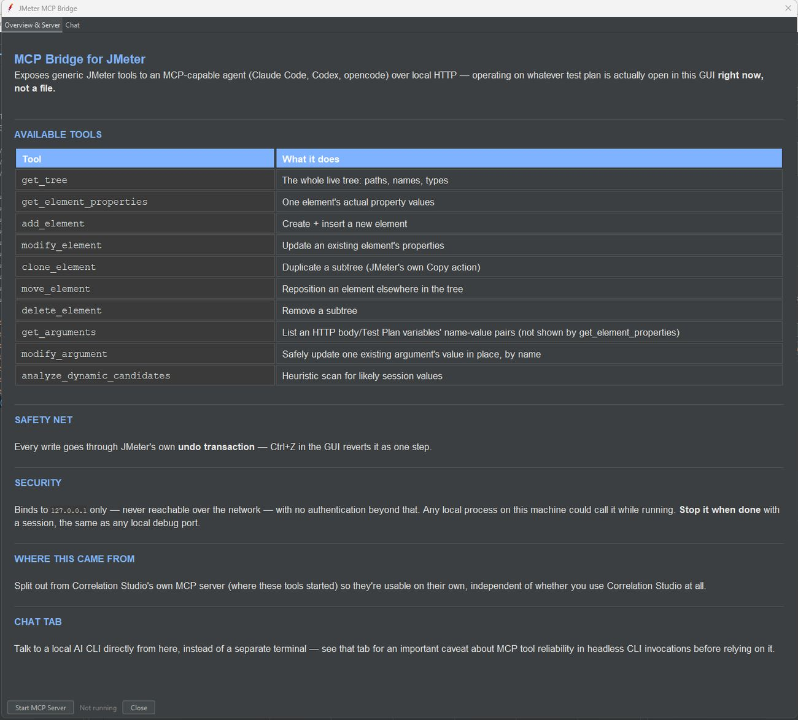

# SmartBlitz MCP Bridge for JMeter


A localhost-only MCP server that lets an AI agent (Claude Code, Codex, opencode) read and edit the test plan currently open in your JMeter GUI.

Part of the **SmartBlitz AI for JMeter** toolkit. Overview and screenshots: https://ajinsudhir.github.io/jmeter-plugins.html

[](LICENSE)

## Features

- **Works on the live plan.** Tools operate on whatever is open in the JMeter GUI right now, not on a file.
- **Ten tools.** `get_tree`, `get_element_properties`, `add_element`, `modify_element`, `clone_element`, `move_element`, `delete_element`, `get_arguments`, `modify_argument` and `analyze_dynamic_candidates` (a heuristic scan for likely session values).
- **Safety net.** Every write goes through JMeter's own undo transaction, so Ctrl+Z reverts it as one step.
- **Chat tab.** Talk to a local AI CLI from inside the plugin, with multiple conversations you can create and delete.
- **Independent.** Split out of Correlation Studio so it works on its own, with or without any other plugin.

## Screenshots


*MCP Bridge: server controls and available tools*

## Requirements

- Apache JMeter 5.6.3 (built and tested against it; other 5.6.x likely compatible)
- Java 11 or newer
- An MCP-capable agent, such as Claude Code, Codex or opencode

## Install

1. Download `jmeter-mcpbridge-1.0.0.jar` from [Releases](../../releases).
2. Copy it into `<JMETER_HOME>/lib/ext/`.
3. Restart JMeter.

Open it from **Tools → SmartBlitz - MCP Bridge...** (also a toolbar icon). No account, no telemetry.

## Build from source

Requires Maven and JDK 11 or newer.

```
mvn clean package
```

The jar is written to `target/jmeter-mcpbridge.jar`. To build against another JMeter version, change `<jmeter.version>` in `pom.xml`.

## Use

Open the dialog, click **Start MCP Server** (default port 7332, endpoint `/mcp`), then register that local HTTP endpoint with your agent. Stop the server when you are done.

## Security

The server is local only and has no authentication beyond that: any local process on the machine could call it while it is running. Start it when needed and stop it afterwards.

## Related plugins

- [JMeter Workbench (Correlation Studio)](https://github.com/ajinsudhir/jmeter-correlationstudio)
- [Insight Dashboard for JMeter](https://github.com/ajinsudhir/jmeter-insightdashboard)

## Docs

- [Detailed changelog and design notes](CHANGELOG.md)

## License

Apache 2.0, see [LICENSE](LICENSE).

## Author

Ajin Sudhir, [github.com/ajinsudhir](https://github.com/ajinsudhir)
